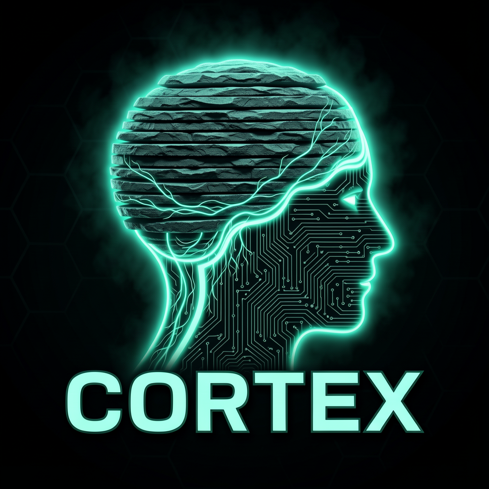

<p align="center">
  
</p>

<h3 align="center">Run DeepSeek-V4.1-Flash on two GPUs — or on your desk</h3>

<p align="center"><b>Cortex</b> · by <b>TheMindExpansionNetwork</b> · local, private, MIT</p>

<p align="center"><a href="https://github.com/TheMindExpansionNetwork/Cortex/releases"></a>
<a href="LICENSE"></a>
<a href="NOTICE.md"></a></p>

---

**Cortex** is our build of a local inference stack for the newest frontier model —
[**DeepSeek-V4.1-Flash-1017**](https://huggingface.co/deepseek-ai/DeepSeek-V4.1-Flash-1017) — a 552B-backbone Mixture-of-Experts
model with only **8B parameters active on input and 16B on output**, a **1M-token context window**, native vision,
and a 196B-parameter **Engram** n-gram memory that streams from disk.

The architecture idea is simple and radical: **you should not need a data center to run a frontier model.**
DeepSeek's own KV compression (≈890 bytes/token global KV, ~437× smaller than V1) plus Cortex's hierarchical
expert memory mean a model of this class runs on a **two-GPU workstation** at a fraction of the power of a
full serving node — see [docs/POWER-ANALYSIS.md](docs/POWER-ANALYSIS.md).

Cortex is a rebrand and extension of [**Strata**](https://github.com/Niko1221/Strata) by Niko1221 (MIT) —
an inference engine built around exactly the three tricks this model needs: **hot experts in VRAM, all
experts in RAM, the n-gram lookup table on SSD**, plus speculative drafting. See [NOTICE.md](NOTICE.md)
for what we changed and why.

## What we are building

| Phase | Goal | Status |
| --- | --- | --- |
| P0 | Repo, rebrand, integration plan, GPU test plan, power analysis | **done — this commit** |
| P1 | Port the `deepseek41` GGUF architecture into the Cortex engine (from upstream llama.cpp) | **scaffolded** — family recognition + engine stub live, reference vendored, port map written |
| P2 | Map Engram table → Strata's proven SSD n-gram reader (on-demand mmap rows) | **contract live** — reader wiring next |
| P3 | Map DSpark speculative decoding → Strata's coupled-draft/MTP path | **contract live** — controller wiring next |
| P4 | Bring-up + benchmarks on **2× A100 80GB** (and a consumer-GPU tier table) | ready — awaits hardware |
| P5 | Our own signed engine builds + release feed (replace upstream feed) | in progress |
| P6 | One-command hosting: RunPod/Modal A100 recipe, OpenAI-compatible endpoint | in progress |

The full spec: [docs/ROADMAP.md](docs/ROADMAP.md) · model deep-dive: [docs/CORTEX-DEEPSEEK.md](docs/CORTEX-DEEPSEEK.md)
· test protocol: [docs/GPU-TEST-PLAN.md](docs/GPU-TEST-PLAN.md) · the watts: [docs/POWER-ANALYSIS.md](docs/POWER-ANALYSIS.md)

## Why 2× A100 is the target

The Unsloth quants of this model split cleanly: the non-Engram weights at 1-bit fit inside **139.8 GB**,
and the Engram table (110.6 GB as IQ4_NL) **does not need to be in VRAM at all** — it is read a few rows
per token through the OS cache, SSD or RAM.

| Quant | Total on disk | Non-Engram weights | Fits 2× A100 (160 GB VRAM)? |
| --- | ---: | ---: | --- |
| **UD-IQ1_M** (recommended) | 250.4 GB | 139.8 GB | **yes** — ~18 GB free for KV + vision encoder + buffers |
| UD-IQ1_S | 233.0 GB | 122.4 GB | yes — most headroom, slightly lower quality (87–88% top-1 agreement vs original) |
| UD-Q2_K_XL | 334.8 GB | 199.6 GB | no (needs ~40 GB more; possible with aggressive expert offload, slower) |
| UD-Q3_K_XL and up | ≥ 485 GB | ≥ 282 GB | data-center tier |

Quality reference (Unsloth, top-1 agreement vs DeepSeek's F32 reference): IQ1_M ≈ 87–88%, IQ3_XXS ≈ 95%,
Q4_K_XL ≈ 98%. Numbers, tables and sources: [docs/CORTEX-DEEPSEEK.md](docs/CORTEX-DEEPSEEK.md).

**Power headline:** 8× B200 reference serving node ≈ **8+ kW**. Our 2× A100 build ≈ **0.8–1.1 kW total system**
(SXM: 800 W GPUs + ~250 W host; PCIe: 600 W). That is a **~90% cut in GPU power** for a model that scores at
or above frontier models on agentic coding benchmarks (Terminal-Bench 4.0, DeepSWE, CyberGym — see the
[DeepSeek 1017 card](https://huggingface.co/deepseek-ai/DeepSeek-V4.1-Flash-1017)).

## What works today (from upstream Strata)

The engine in this repo currently serves the **Qwen3.8-Flash-Next** family (125B) on consumer hardware —
the installer fetches signed engine builds from the upstream feed, so the app, the `cortex` CLI and the
OpenAI/Anthropic-compatible localhost API all work out of the box for those models. DeepSeek-V4.1-Flash
support lands with Phase P1–P3 (no engine rebuild required for the Qwen path).

```sh
# Terminal (Linux / Mac / Windows PowerShell)
curl -fsSL https://github.com/Niko1221/Strata/releases/latest/download/install.sh | sh
cortex launch
```

The engine, model catalog and update feed still point to the upstream signed release until our own CI
(P5) publishes Cortex builds — deliberate, so the stack stays functional while we port. Details in
[NOTICE.md](NOTICE.md).

## When P4 lands: one script

```sh
scripts/deepseek-2xa100.sh --quant IQ1_M --ctx 65536
# downloads quant shards + vision encoder + Engram table from
# unsloth/DeepSeek-V4.1-Flash-1017-GGUF, then launches the engine
# split across both A100s with the recommended sampling settings.
```

## Super-easy interface

- **Desktop app** (from upstream Strata, rebranded): pick a model, chat, images on by default.
- **`cortex` CLI** for scripts and agents.
- **OpenAI + Anthropic compatible API** on `localhost` — Claude Code, Codex CLI, OpenCode and friends plug straight in.
- **No cloud, no account, no telemetry.** Your data stays on your machine.

## Credits & license

Cortex is built on [Strata](https://github.com/Niko1221/Strata) by Niko1221 and contributors (MIT), which
itself builds on [llama.cpp / ggml](https://github.com/ggml-org/llama.cpp). The model is
[DeepSeek-V4.1-Flash-1017](https://huggingface.co/deepseek-ai/DeepSeek-V4.1-Flash-1017) by DeepSeek (MIT);
GGUF quants by [Unsloth](https://huggingface.co/unsloth) (Dynamic 3.0). Model files carry their own
licenses. Cortex's own changes are MIT — full attribution in [NOTICE.md](NOTICE.md).

*Upstream translations of the original Strata docs live in the Strata repo; this fork ships English docs.*
